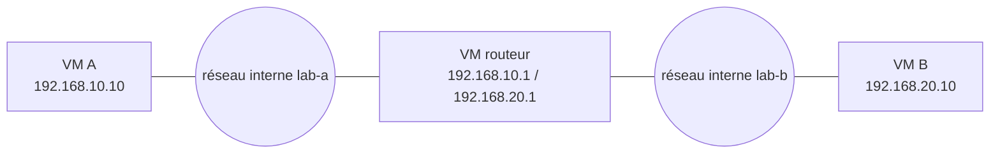

# Cours – Virtualisation : hyperviseurs, instantanés, réseau virtuel

*BTS SIO SISR 2e année – Bloc 2 – S06*

> Un mot ou un sigle inconnu ? Passe la souris dessus, ou ouvre le [glossaire](../../ressources/glossaire.md).

Un serveur physique utilise rarement plus de 20 ou 30 % de ses capacités. La **virtualisation** permet de faire tourner plusieurs « machines » isolées sur un même matériel. C'est l'outil de base de toute infrastructure moderne, et des laboratoires de tes réalisations E6.

---

## 1. Principe et vocabulaire

| Terme | Sens |
|---|---|
| **Hôte** | La machine physique (ou le système) qui fait tourner les machines virtuelles |
| **Invité** | Une machine virtuelle (VM) et son système |
| **Hyperviseur** | Le logiciel qui partage CPU, mémoire, disque et réseau entre les VM |
| **Disque virtuel** | Un fichier (VDI, VMDK, VHDX, qcow2…) qui joue le rôle du disque de la VM |

### Deux familles d'hyperviseurs

| | Type 1 (« bare-metal ») | Type 2 (« hébergé ») |
|---|---|---|
| **Installé** | Directement sur le matériel | Comme une application sur un système existant |
| **Exemples** | Proxmox VE (KVM), VMware ESXi, Hyper-V, Xen | VirtualBox, VMware Workstation |
| **Usage** | Production, serveurs | Poste de travail, laboratoire, tests |
| **Performances** | Meilleures | Un système intermédiaire de plus |

> [!NOTE]
> La frontière n'est pas toujours nette : KVM est intégré au noyau Linux et Hyper-V s'installe comme un rôle de Windows, mais tous deux fonctionnent en pratique comme des hyperviseurs de type 1. En TP, tu utilises **VirtualBox** (type 2) : les notions sont les mêmes qu'en production.

### Virtualisation et conteneurs

Une **VM** embarque un système complet (son propre noyau). Un **conteneur** (Docker, LXC) partage le noyau de l'hôte : plus léger, mais moins isolé. Les deux se complètent ; ce cours traite des VM.

---

## 2. Dimensionner : les ressources sont partagées

| Ressource | Règle de base |
|---|---|
| **Processeur** | Les cœurs virtuels (vCPU) peuvent être **sur-alloués** (plus de vCPU que de cœurs physiques), avec prudence |
| **Mémoire** | À dimensionner **sans excès** : la somme des mémoires des VM doit rester sous la mémoire de l'hôte, en laissant de la marge à l'hôte |
| **Disque** | Allocation **dynamique** (le fichier grossit) ou **fixe** ; attention à la saturation du disque de l'hôte |
| **Réseau** | Les VM partagent les cartes physiques de l'hôte |

**Test flash.** Un hôte a 16 Go de mémoire. Il doit en garder 4 pour lui. Combien de VM de 2 Go peut-il faire tourner sans manquer de mémoire ?

Voir la réponse

(16 − 4) ÷ 2 = **6 VM**. Au-delà, l'hôte utilise le disque comme mémoire (*swap*) et tout ralentit fortement.

**Points de vigilance.** L'hôte devient un **point unique de défaillance** : s'il tombe, toutes ses VM tombent (voir la haute disponibilité en S12). Une **sauvegarde** des VM reste nécessaire (S05).

---

## 3. Les instantanés, les clones et les modèles

| Outil | Ce que c'est | Usage |
|---|---|---|
| **Instantané** (*snapshot*) | L'état d'une VM à un instant, pour y **revenir** | Avant une mise à jour risquée |
| **Clone complet** | Copie indépendante d'une VM | Dupliquer une machine |
| **Clone lié** | Copie qui dépend du disque de la VM d'origine | Gain de place, mais dépendance |
| **Modèle** (*template*) | VM de référence, préparée pour être clonée | Déployer vite (voir S07) |

> [!WARNING]
> **Un instantané n'est pas une sauvegarde.** Il dépend du même disque, grossit avec le temps et ralentit la VM s'il est conservé longtemps. On le garde **peu de temps**, on le supprime une fois la modification validée.

**Préparer un modèle.** Avant de cloner : mettre le système à jour, supprimer ce qui est propre à la machine (clés SSH de l'hôte, identifiant de machine `/etc/machine-id`, journaux), puis l'éteindre. Sans cela, tous les clones auraient la **même identité**.

---

## 4. Le réseau virtuel

| Mode (VirtualBox) | La VM peut joindre… | Les autres peuvent joindre la VM… | Usage |
|---|---|---|---|
| **NAT** | Internet et le réseau de l'hôte | Non (sauf redirections de ports) | Accès Internet pour les mises à jour |
| **Réseau NAT** | Internet et les autres VM du même réseau NAT | Entre VM du même réseau | Petit laboratoire avec Internet |
| **Réseau interne** | Seulement les VM du même réseau interne | Idem | Laboratoire isolé |
| **Accès par pont** | Le réseau physique, comme une machine à part entière | Oui | Service réellement accessible |
| **Réseau privé hôte** | L'hôte et les VM du même réseau | L'hôte | Administrer les VM depuis l'hôte |

Un **commutateur virtuel** relie les cartes virtuelles entre elles (le « pont » de Linux, `vmbr0` sous Proxmox, le *vSwitch* de Hyper-V). Pour relier **deux sous-réseaux**, on utilise une **VM routeur** à deux cartes : sa fonction de routage est activée (`net.ipv4.ip_forward=1`) et ses clients l'ont pour passerelle.

## Ce que tu dois retenir de la séance

- L'**hyperviseur** partage les ressources ; **type 1** pour la production, **type 2** pour le poste et le laboratoire.
- On **dimensionne** et on garde une marge pour l'hôte ; l'hôte est un **point unique de défaillance**.
- **Instantané ≠ sauvegarde** ; on prépare un **modèle** avant de cloner.
- Le **réseau interne** isole un laboratoire ; une **VM routeur** relie deux sous-réseaux.
