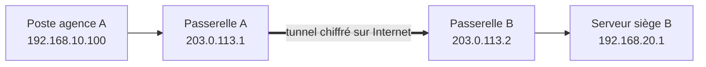

# Cours – VPN entre deux sites et accès distant sécurisé

*BTS SIO SISR 2e année – Bloc 2 – S10*

> Un mot ou un sigle inconnu ? Passe la souris dessus, ou ouvre le [glossaire](../../ressources/glossaire.md).

Deux agences veulent partager un serveur de fichiers. Louer une liaison dédiée coûte cher ; passer par Internet sans protection expose le trafic. Le **VPN** (*Virtual Private Network*, réseau privé virtuel) crée, **à travers Internet**, un canal **chiffré et authentifié** entre deux réseaux ou entre un poste et un réseau.

---

## 1. Deux usages

| | VPN **site à site** | VPN **d'accès nomade** (*road warrior*) |
|---|---|---|
| **Relie** | Deux réseaux (agence ↔ siège) | Un poste isolé ↔ le réseau de l'entreprise |
| **Où est le VPN ?** | Dans les **passerelles** (routeurs, pare-feu) | Dans un **logiciel client** sur le poste |
| **Pour l'utilisateur** | Transparent : il ne fait rien | Il active la connexion |
| **Adresse de l'extrémité** | Fixe et connue des deux côtés | Souvent variable (domicile, hôtel) |

---

## 2. Ce que garantit un VPN

| Propriété | Signification |
|---|---|
| **Confidentialité** | Le contenu est chiffré : un espion sur Internet ne le lit pas |
| **Intégrité** | Toute modification du paquet en route est détectée |
| **Authentification** | Chaque extrémité prouve son identité (clé, certificat, secret partagé) |

> [!WARNING]
> Un VPN protège le **trajet**, pas les **extrémités**. Un poste infecté qui se connecte au VPN apporte le problème **à l'intérieur** du réseau. Le VPN s'accompagne d'un **filtrage** (pare-feu, droits d'accès) et de postes à jour.

### Le principe : l'encapsulation

Le paquet d'origine (adresses privées) est **chiffré**, puis placé dans un **nouveau paquet** (adresses publiques des passerelles) qui traverse Internet.

---

## 3. Les technologies

| Technologie | Particularités |
|---|---|
| **IPsec** | Standard très répandu, présent dans la plupart des routeurs et pare-feu ; configuration riche, donc plus complexe (IKE, associations de sécurité) |
| **OpenVPN** | Fondé sur TLS, fonctionne sur TCP ou UDP, souvent utilisé pour l'accès nomade |
| **WireGuard** | Récent, intégré au noyau Linux, configuration courte (une paire de clés par extrémité), cryptographie moderne imposée |
| **SSL/TLS VPN, accès « portail »** | Accès à des applications via le navigateur |

Le choix dépend de l'**interopérabilité** (avec quels équipements parle-t-on ?), de la **taille** de l'infrastructure et des **compétences** de l'équipe. Dans ce cours, le TP utilise WireGuard, pour sa simplicité ; les principes valent pour les autres.

### Le plan d'adressage

Les deux réseaux reliés doivent avoir des **plages différentes** : si les deux agences utilisent `192.168.1.0/24`, le routage est impossible.

| Élément | Exemple |
|---|---|
| Réseau agence A | 192.168.10.0/24 |
| Réseau agence B | 192.168.20.0/24 |
| Réseau du tunnel (point à point) | 10.99.0.0/30 (2 adresses utilisables) |
| Adresses publiques des passerelles | 203.0.113.1 et 203.0.113.2 (plage de documentation, réservée aux exemples) |

---

## 4. WireGuard en deux minutes

Chaque extrémité (un **pair**) possède une **paire de clés** : une clé **privée** (secrète, ne quitte jamais la machine) et une clé **publique** (que l'on donne à l'autre). Chaque pair déclare :

| Paramètre | Rôle |
|---|---|
| `PrivateKey` | La clé privée locale |
| `Address` | L'adresse de l'interface du tunnel (`wg0`) |
| `ListenPort` | Le port UDP d'écoute (51820 par convention) |
| `PublicKey` (du pair) | Qui est autorisé à se connecter |
| `Endpoint` | L'adresse publique et le port du pair |
| `AllowedIPs` | Les réseaux joignables **par ce pair** : sert à la fois de **routage** et de **filtrage** |

Les paquets envoyés dans le tunnel vers un réseau listé dans `AllowedIPs` sont chiffrés pour ce pair ; les paquets reçus ne sont acceptés que s'ils viennent d'une adresse autorisée.

### Les points à ne pas oublier

- **Routage** : la passerelle doit transmettre les paquets (`net.ipv4.ip_forward=1`), et les postes l'ont pour **passerelle**.
- **Pare-feu** : autoriser le port UDP du VPN en entrée sur la passerelle, et décider **quoi** peut traverser le tunnel.
- **Clés** : la clé privée est un **secret** (droits `600`, jamais dans Git, jamais envoyée par messagerie).
- **Surveillance** : la date de dernière poignée de main (`wg show`) indique si le tunnel est vivant.

**Test flash.** Dans un VPN site à site, pourquoi les deux réseaux doivent-ils avoir des plages d'adresses différentes ?

Voir la réponse

Parce que la passerelle doit pouvoir décider si un paquet est destiné au réseau **local** ou au réseau **distant**. Avec deux réseaux identiques, l'adresse `192.168.1.10` désignerait deux machines différentes et le routage serait ambigu.

## Ce que tu dois retenir de la séance

- Un **VPN** chiffre et authentifie à travers Internet ; **site à site** (entre passerelles) ou **nomade** (client).
- Il apporte **confidentialité, intégrité, authentification** ; il ne protège pas les extrémités.
- Plans d'adressage **distincts** ; routage activé ; port du VPN ouvert ; clé privée **secrète**.
- On **vérifie** que le trafic est chiffré (capture) et que le tunnel est actif.
