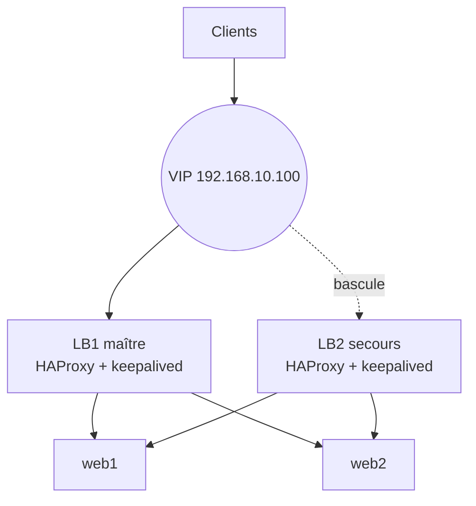

# Cours – Haute disponibilité et répartition de charge

*BTS SIO SISR 2e année – Bloc 2 – S12*

> Un mot ou un sigle inconnu ? Passe la souris dessus, ou ouvre le [glossaire](../../ressources/glossaire.md).

Le serveur web du cabinet tombe un vendredi à 17 h. Si le service s'arrête jusqu'à lundi, c'est un problème de **disponibilité**. En S05, tu as vu comment **repartir** après un sinistre. Ici, on cherche à **ne pas s'arrêter** : le service continue sur un autre serveur, souvent sans que l'utilisateur s'en aperçoive.

---

## 1. Trois notions à ne pas confondre

| Notion | Idée | Exemple |
|---|---|---|
| **Tolérance de panne** | Un composant défaillant est **compensé** immédiatement par un composant redondant | Alimentation double, disques en RAID |
| **Haute disponibilité** (HA) | Si un serveur tombe, un autre **prend le relais** après une courte interruption | Deux serveurs avec une adresse IP flottante |
| **Répartition de charge** (*load balancing*) | Le trafic est **réparti** entre plusieurs serveurs ; il augmente la capacité et, si le répartiteur détecte les pannes, la disponibilité | HAProxy devant deux serveurs web |

Ces notions se combinent : deux répartiteurs en haute disponibilité devant plusieurs serveurs web.

---

## 2. Chiffrer la disponibilité

La disponibilité s'exprime en **pourcentage de temps** pendant lequel le service est rendu.

| Disponibilité | Indisponibilité maximale par an | Par mois (30 jours) |
|---|---|---|
| 99 % | 87,6 heures | 7,2 heures |
| 99,5 % | 43,8 heures | 3,6 heures |
| 99,9 % | **8,76 heures** (8 h 45 min) | **43,2 minutes** |
| 99,95 % | 4,38 heures | 21,6 minutes |
| 99,99 % | **52,6 minutes** | 4,3 minutes |

(Calcul : indisponibilité = (1 − disponibilité) × 8 760 heures par an.)

### Composer les disponibilités

| Montage | Calcul | Exemple |
|---|---|---|
| **En série** : tout doit fonctionner | Produit des disponibilités | Deux composants à 99,9 % : 0,999 × 0,999 = **99,8 %** |
| **En parallèle (redondance)** : un seul suffit | 1 − produit des indisponibilités | Deux serveurs à 99 % : 1 − 0,01 × 0,01 = **99,99 %** |

Deux lectures à retenir :

1. **Chaque maillon en série diminue** la disponibilité d'ensemble ; une chaîne n'est pas plus fiable que son maillon le plus faible.
2. **La redondance** augmente fortement la disponibilité **si les pannes sont indépendantes** et si la bascule fonctionne. Deux serveurs sur le même hôte physique, la même alimentation ou le même commutateur partagent un **point unique de défaillance** (SPOF) : le calcul ne s'applique plus.

**Test flash.** Un site utilise un répartiteur unique (99,9 %) devant deux serveurs web (99 % chacun, en parallèle). Quelle disponibilité d'ensemble ?

Voir la réponse

Serveurs en parallèle : 1 − 0,01 × 0,01 = 0,9999. En série avec le répartiteur : 0,999 × 0,9999 ≈ **0,9989**, soit **99,89 %**. Le répartiteur unique devient le maillon faible : d'où l'intérêt de le **doubler** aussi.

---

## 3. La répartition de charge

Un **répartiteur** (HAProxy, nginx, matériel dédié) reçoit les requêtes et les envoie aux serveurs du **groupe** (le *backend*).

| Algorithme | Principe | Usage |
|---|---|---|
| **Tourniquet** (*roundrobin*) | Chaque serveur à tour de rôle | Serveurs identiques |
| **Moins de connexions** (*leastconn*) | Le serveur le moins occupé | Requêtes de durées très variables |
| **Hachage de l'adresse source** | Un même client va vers le même serveur | Garder un client sur un serveur |

### Les points clés

- **Sondes de santé** (*health checks*) : le répartiteur teste régulièrement chaque serveur (`check`) et **retire** celui qui ne répond plus. Sans sonde, il enverrait des requêtes à un serveur mort.
- **Persistance de session** : si l'application garde des données de session **sur le serveur**, il faut renvoyer le client au même serveur (cookie, hachage) ou, mieux, **partager l'état** (base, cache externe).
- **Le répartiteur lui-même** est un SPOF s'il est seul.

---

## 4. L'adresse IP flottante

Pour doubler le répartiteur, deux machines se partagent une adresse **virtuelle** (VIP). Les clients ne connaissent que la VIP.

**VRRP** (*Virtual Router Redundancy Protocol*) est le protocole utilisé : le maître envoie des annonces périodiques ; si le secours n'en reçoit plus, il **prend la VIP** (et annonce le changement aux voisins). **keepalived** implémente VRRP sous Linux et permet d'ajouter un **script de vérification** : si HAProxy s'arrête sur le maître, sa priorité baisse et le secours prend le relais.

| Paramètre | Rôle |
|---|---|
| `state` | État de départ (MASTER ou BACKUP) |
| `priority` | Le plus élevé devient maître |
| `virtual_router_id` | Identifiant du groupe, **identique** sur les deux machines et unique sur le réseau |
| `advert_int` | Intervalle entre annonces (secondes) |
| `track_script` | Script de vérification du service |

> [!WARNING]
> **Attention à la partition (« split brain »).** Si les deux machines cessent de se voir sans être en panne, **chacune** croit être le maître et prend la VIP : deux machines répondent à la même adresse. On limite le risque par des liens de communication fiables et une authentification, et on **supervise** l'état (S11).

---

## 5. Limites à connaître

| Limite | Remède |
|---|---|
| Le **stockage** partagé reste un SPOF | Stockage répliqué ou redondant |
| La **base de données** ne se duplique pas comme un serveur web | Réplication de base, grappe |
| La haute disponibilité **ne remplace pas la sauvegarde** | Voir S05 : une suppression est répliquée aussitôt |
| Le coût augmente | Arbitrage disponibilité / coût avec le client (S02, S03) |
| Un système HA **non testé** ne vaut rien | Provoquer une panne régulièrement et mesurer |

## Ce que tu dois retenir de la séance

- **Tolérance de panne**, **haute disponibilité** et **répartition de charge** sont trois choses différentes qui se combinent.
- Disponibilité : **série** = produit ; **parallèle** = 1 − produit des indisponibilités ; attention aux SPOF.
- Un répartiteur a des **sondes de santé** ; la **VIP** (VRRP, keepalived) double le répartiteur.
- **Tester** la bascule, **mesurer** l'interruption. La HA ne remplace pas la sauvegarde.
